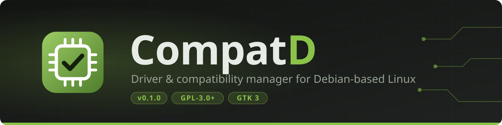

<p align="center">
  
</p>

<p align="center">
  
  
  
  
</p>

**Driver and compatibility manager for Debian-based Linux.** Version **0.1.0**, a pre-release until it has been tested more widely.

CompatD opens as a full-window GTK app. Its colour theme follows the distribution it runs on:

| Distribution | Theme |
|---|---|
| Kali Linux | dark, Kali blue |
| Debian | dark grey, Debian red header and accent |
| MX Linux | grey, steel-blue accent |
| LMDE | dark, mint green |
| anything else | dark, neutral teal |

You can override the theme and force dark or light mode under **Options**.

## What it does

### Drivers
* Lists every PCI and USB device with its vendor, IDs, the **driver in use** and the available kernel modules. Devices without a driver are shown in red.
* Recommends packages that match the hardware: NVIDIA (`nvidia-driver`, which uses `nvidia-detect` when it is installed), AMD and Intel graphics firmware plus Mesa/VA-API, Intel/Realtek/Broadcom/Atheros/MediaTek Wi-Fi and Bluetooth firmware, SOF audio firmware, CPU microcode, CUPS/SANE, BlueZ, and the CUDA toolkit on Kali.
* Each recommendation slot lists alternative package names, newest naming first (for example `firmware-intel-graphics` → `firmware-misc-nonfree`, `libfuse2t64` → `libfuse2`). So one rule works on Debian 12/13, Kali rolling, MX and LMDE.
* **Install selected** runs `apt-get` through `pkexec` after you confirm the exact commands. **Simulate** runs `apt-get -s` and needs no password. **Copy commands** puts the `sudo …` lines on the clipboard.

### Compatibility: this device
* GPUs, NICs and other important devices with no driver bound. This includes the "nouveau blacklisted but the NVIDIA driver is not installed" trap.
* Missing firmware reported by the kernel, with the package that provides it.
* Ubuntu PPAs or Ubuntu suites on Debian ("FrankenDebian"), Debian repos added to Kali, mixed Debian releases, and a missing `non-free-firmware` component.
* Broken or half-installed packages (`dpkg --audit`), unmet dependencies, held packages, and installed packages that no repository provides any more.
* DKMS modules that were not built for the running kernel, missing kernel headers, Secure Boot combined with unsigned modules, and NVIDIA modesetting under Wayland.

### Compatibility: a directory
The scanner never executes the files it inspects. It parses ELF files itself instead of running `ldd`.

| Finds | Suggests |
|---|---|
| Binaries for another CPU architecture | the native build, `qemu-user-binfmt`, or i386/armhf multiarch |
| Missing shared libraries | the Debian package (soname → package rules + optional `apt-file`), or explains ABI changes such as `libssl.so.1.1` → `libssl.so.3` |
| Binaries built against a newer glibc/libstdc++ than the system has | backports, Flatpak/AppImage, or a rebuild |
| musl / NixOS loaders | `musl`, `patchelf` |
| AppImages without FUSE 2 or the exec bit | `libfuse2t64`/`libfuse2`, `chmod +x` |
| Kernel modules built for another kernel | DKMS + headers |
| Scripts with missing interpreters, macOS/BSD shebangs, CRLF line endings | the package, a rewritten shebang, LF conversion |
| Python 2 sources | porting advice |
| `.desktop` launchers and systemd units that point at missing programs | reinstalling or removing them |
| `.deb` files with unsatisfiable dependencies, wrong architecture, or Ubuntu builds | a matching build |
| `.rpm`, Arch, Snap, Flatpak, `.jar` | `alien`, `snapd`, `flatpak`, `default-jre` |
| Windows `.exe`/`.msi`/`.bat`/`.ps1` and macOS Mach-O/`.dmg` | **native alternatives** (PuTTY, FileZilla, 7-Zip, LibreOffice, Remmina, …) or Wine |
| Broken symlinks | removal |

You can apply each fix on its own, or merge them with **Apply all fixes**. That merges only root-level apt fixes into one `apt-get install`; per-file edits are never run as root. You can export results as Markdown or JSON.

### Options and activity
* Theme, brightness, start in fullscreen, dry-run mode, which recommendations to show, every scanner check, file limits, and `apt-file` lookup. Settings are saved to `~/.config/compatd/config.json`.
* **Activity** streams the output of every command CompatD runs, and you can save it as a log.

Keyboard shortcuts: **F5** refreshes, **F11** toggles fullscreen, **Ctrl+Q** quits.

## Running

Requirements: Python ≥ 3.9, `python3-gi`, `gir1.2-gtk-3.0`, `pciutils`, `usbutils`, `kmod`, `pkexec`. These are present by default on Kali, Debian desktops, MX and LMDE.

```sh
./bin/compatd                 # GUI
./bin/compatd --theme mx      # GUI with a forced theme
./bin/compatd info            # system summary
./bin/compatd drivers         # devices + recommendations
./bin/compatd system          # device compatibility check
./bin/compatd scan ~/Downloads [--json] [--hidden] [--apt-file]
```

Build and install a package:

```sh
make deb                      # -> dist/compatd_0.1.0_all.deb
sudo apt install ./dist/compatd_0.1.0_all.deb
```

Run the tests with `make test`.

## Safety
* Detection and scanning are read-only and run as your user.
* Every change goes through a confirmation dialog that lists the exact commands, and only then through `pkexec`. Dry-run mode simulates everything.
* Commands are argv lists that are quoted before they reach the shell. File paths are never interpolated unquoted.

## Status
0.1.0 is the first feature-complete build. It has been tested on real hardware on:

* Kali rolling (amd64, NVIDIA + AMD hybrid laptop)
* LMDE 7 "gigi" (amd64, Cinnamon on X11, AMD Ryzen 7 7735HS + Radeon 680M with an NVIDIA RTX 4060 laptop GPU)

Debian and MX detection and themes are covered by unit tests. They still need real-world testing before a 1.0 release.

## Contributing
Bug reports, hardware test reports and pull requests are welcome. Reports from Debian and MX Linux machines help most right now. See [CONTRIBUTING.md](CONTRIBUTING.md) for how to report a problem, run the tests and send changes. Everyone taking part is expected to follow the [Code of Conduct](CODE_OF_CONDUCT.md).

To report a security problem, follow [SECURITY.md](SECURITY.md). Please don't open a public issue for it.

## License
Copyright © 2026 unforged1

CompatD is free software: you can redistribute it and/or modify it under the terms of the GNU General Public License as published by the Free Software Foundation, either version 3 of the License, or (at your option) any later version. See [LICENSE](LICENSE), or **License** in the app's menu.

The GPLv3 logo (`data/gplv3.svg`) is by the Free Software Foundation. It is in the public domain and is a trademark of the FSF.
